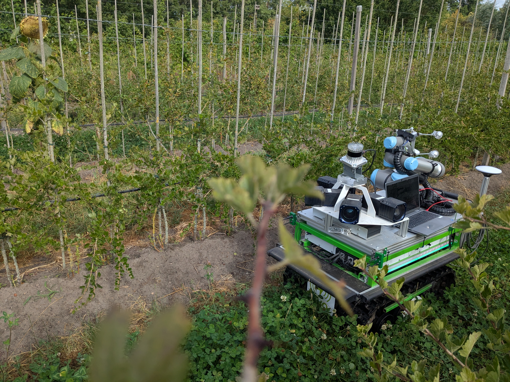
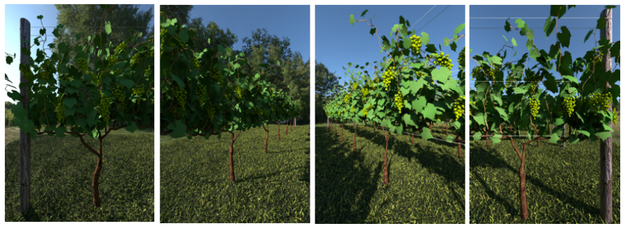
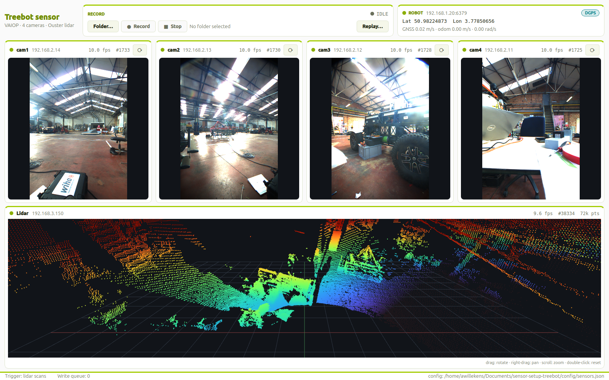
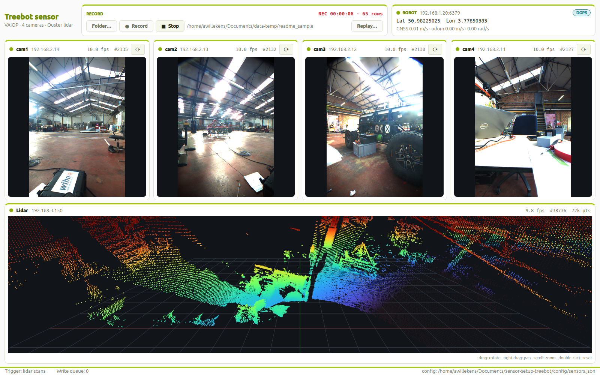
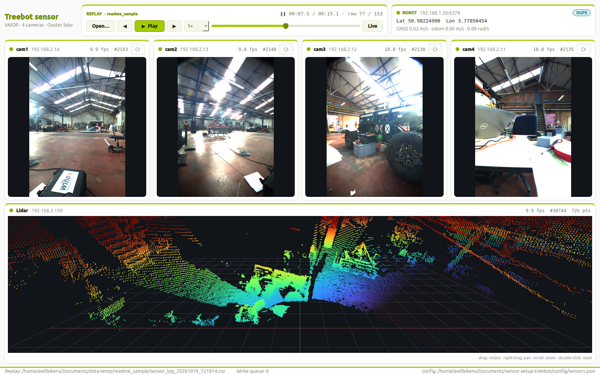

# VAIOP sensor setup (treebot)



A Qt5 desktop application that records synchronised data from the VAIOP treebot sensor:

* **4× Daheng GigE colour cameras** (Galaxy SDK)
* **1× Ouster lidar** (Ouster SDK)
* **Robot state** (GNSS fix, pose, velocities) read from the robot's **Redis** server (ARTOF)

The GUI shows the live camera images and the point cloud, and when recording it writes images, point clouds and a CSV log with timestamps and robot metadata.



*The four camera views of the rig, here in a virtual vineyard.*

## How it works

```
QTimer (every 5 ms, GUI thread, never blocks)
 ├─ new lidar scan?  (or every 100 ms when no lidar is connected)
 │    ├─ point cloud -> LidarWidget   (+ queue lidar/<index>.ply when recording)
 │    ├─ latest robot state            (polled from Redis in a background thread)
 │    └─ add a pending row with the trigger timestamp (the lidar timestamp)
 └─ oldest pending row complete?  (every camera has a frame at/after the trigger, or 150 ms passed)
      each camera: frame closest to the trigger -> CameraWidget (+ queue camN/<index>.png when recording)
      RecordWidget::logData()  (one CSV row)
```

* The **lidar scan is the trigger**: every new scan collects, for each camera, the frame whose timestamp is closest to the lidar timestamp, plus the latest robot state into one CSV row. Without a lidar the rows are triggered at 10 Hz.
* The cameras are free running (not hardware triggered), so a camera frame is up to half a frame period away from the lidar timestamp. Frames more than 50 ms away are not logged, and a frame is never logged in two rows.
* Several rows can be pending at once, so waiting for the cameras never delays the next lidar scan. Rows are logged in trigger order.
* Each camera runs its own acquisition thread (`Daheng::acquisitionLoop`), which keeps its last 8 frames (with timestamps) in memory.
* The robot state is read from Redis in a background thread (10 Hz, 300 ms timeout), so a missing robot never blocks or crashes the GUI.
* At start-up `resetTimestamp()` is called back-to-back on the lidar and all cameras. This maps each sensor clock onto host time (µs since epoch), so their timestamps can be compared.
* Images and point clouds are written by a pool of 4 writer threads (`AsyncWriter`). The queue is bounded: if the disk cannot keep up, files are dropped and the status bar shows how many. On exit the queue is flushed, so no file is cut off.

## Hardware & network

| Device | IP | Notes |
|---|---|---|
| cam1 | `192.168.2.14` | rotated 90° CCW |
| cam2 | `192.168.2.13` | rotated 90° CW |
| cam3 | `192.168.2.12` | rotated 90° CCW |
| cam4 | `192.168.2.11` | rotated 90° CW |
| PC (camera network) | `192.168.2.25` | |
| Ouster lidar | `192.168.3.150` | connected through the USB-ethernet adapter |
| PC (lidar network) | `192.168.3.25` | USB-ethernet adapter, must be set manually (see below) |
| Robot Redis | `192.168.1.20:6379` | ARTOF robot state |

These addresses live in [`config/sensors.json`](config/sensors.json) (see [Configuration](#configuration)). All executables use this file.

### USB-ethernet adapter for the lidar

If the lidar cannot be reached, force the static IP on the USB-ethernet interface:

```bash
nmcli device show | grep enx      # find the interface name
sudo nmcli device modify enxc8a362b68f2a ipv4.addresses 192.168.3.25/24 ipv4.method manual
```

## Installation

Tested on **Ubuntu 24.04** (x86_64). The steps below go from a clean machine to a running application.

### 1. Get the code

```bash
git clone git@gitlab.ilvo.be:vaiop/sensor-setup-treebot.git
cd sensor-setup-treebot
```

### 2. System packages

```bash
sudo apt update
sudo apt install build-essential cmake git pkg-config \
    qtbase5-dev qtbase5-dev-tools libqt5opengl5-dev libgl1-mesa-dev \
    libopencv-dev libpcl-dev libeigen3-dev libboost-all-dev \
    libssl-dev libcurl4-openssl-dev \
    libjsoncpp-dev libspdlog-dev libtins-dev libglfw3-dev libpng-dev
```

The last line holds the build dependencies of the Ouster SDK.

### 3. Redis client (hiredis + redis++)

Both are built from source and installed in `/usr/local`:

```bash
git clone https://github.com/redis/hiredis.git
cd hiredis && make && sudo make install && cd ..

git clone https://github.com/sewenew/redis-plus-plus.git
cd redis-plus-plus && mkdir build && cd build
cmake -DREDIS_PLUS_PLUS_CXX_STANDARD=17 ..
make -j && sudo make install && cd ../..
sudo ldconfig
```

### 4. Ouster SDK

The C++ SDK is built from source and installed in `/usr/local` (CMake finds it as `OusterSDK`):

```bash
git clone https://github.com/ouster-lidar/ouster-sdk.git thirdparty/ouster-sdk
cd thirdparty/ouster-sdk && mkdir build && cd build
cmake -DCMAKE_BUILD_TYPE=Release -DBUILD_VIZ=OFF -DBUILD_PCAP=OFF -DBUILD_EXAMPLES=OFF ..
make -j && sudo make install && cd ../../..
```

### 5. Daheng Galaxy SDK (cameras)

1. Download the **Galaxy Linux SDK** (x86_64) from the [Daheng Imaging website](https://www.daheng-imaging.com/) and run its installer. It installs `/usr/lib/libgxiapi.so` and the **GalaxyView** and **GxGigeIPConfig** tools.
2. Copy the extracted SDK folder to `thirdparty/Galaxy_camera`, so that the headers are in `thirdparty/Galaxy_camera/inc`.
3. Recommended for GigE cameras (both scripts are in the SDK folder, run them once with `sudo`):
   * `set_all_nic_mtu_9000.sh`: jumbo frames (MTU 9000) on the camera network cards
   * `SetSocketBufferSize.sh`: larger receive buffers, so fewer frames are lost

### 6. Segmentation model (optional)

The segmentation colour mode needs [ONNX Runtime](https://onnxruntime.ai/) and a pretrained model. One script downloads both (ONNX Runtime 1.20.1 to `thirdparty/onnxruntime`, the model to `models/`):

```bash
scripts/download_models.sh          # SegFormer-B0 (15 MB, fast enough on the CPU)
scripts/download_models.sh b2       # SegFormer-B2 (sharper; for a GPU build of ONNX Runtime)
```

Without ONNX Runtime the application still builds; the segmentation mode is then disabled. CMake reports `ONNX Runtime found … (point cloud segmentation enabled)` when it is used.

`thirdparty/` and `models/` are git-ignored, so steps 4 to 6 have to be done on every new machine.

### 7. Network

Give the PC a static address on each sensor network (see [Hardware & network](#hardware--network)):

* `192.168.2.25/24` on the camera network card
* `192.168.3.25/24` on the USB-ethernet adapter of the lidar (see [USB-ethernet adapter for the lidar](#usb-ethernet-adapter-for-the-lidar))

Check that the sensors answer: `ping 192.168.2.11` (cameras .11 to .14) and `ping 192.168.3.150` (lidar). If the camera addresses are different, set them with **GxGigeIPConfig** or change [`config/sensors.json`](#configuration).

### 8. Build

```bash
mkdir -p build && cd build
cmake -DCMAKE_BUILD_TYPE=Release ..
make -j
```

Executables are placed in `build/bin/`. Without `CMAKE_BUILD_TYPE` the build is Release. Use a separate folder for a Debug build (`mkdir build-debug && cd build-debug && cmake -DCMAKE_BUILD_TYPE=Debug ..`): it is fine for the debugger, but colouring the point cloud with the cameras takes ~0.5 s per scan instead of ~5 ms, too slow for the live view. The project uses C++23.

AddressSanitizer is off by default. Enable it with `cmake -DENABLE_ASAN=ON ..` (or `NO_ASAN=0 cmake ..`).

### Dependencies

| Library | Used for |
|---|---|
| Qt5 (Core, Gui, Widgets, OpenGL) | GUI, point cloud viewer (OpenGL 3.3), JSON |
| OpenCV | image handling, saving PNGs |
| PCL (io) | saving point clouds as binary PLY |
| Eigen3 | matrices (calibration, projection) |
| Boost (json, system, filesystem, context, thread) | parsing the robot state JSON |
| OpenSSL, libcurl | Ouster HTTP client |
| hiredis + redis++ | Redis connection to the robot |
| Ouster SDK (`OusterSDK::ouster_sensor`) | lidar |
| Daheng Galaxy SDK | cameras: `/usr/lib/libgxiapi.so`, headers in `thirdparty/Galaxy_camera/inc` |

## Configuration

`config/sensors.json`:

```json
{
  "lidar":   { "ip": "192.168.3.150" },
  "cameras": [
    { "name": "cam1", "ip": "192.168.2.14", "rotation": "ccw" },
    { "name": "cam2", "ip": "192.168.2.13", "rotation": "cw" },
    { "name": "cam3", "ip": "192.168.2.12", "rotation": "ccw" },
    { "name": "cam4", "ip": "192.168.2.11", "rotation": "cw" }
  ],
  "robot":   { "host": "192.168.1.20", "port": 6379 },
  "calibration": "config/calib.json",
  "pointcloud_color": "rgb",
  "segmentation": {
    "model": "models/segformer-b0-ade",
    "input_size": 512,
    "threads": 0,
    "min_confidence": 0.0
  }
}
```

* `rotation`: `cw`, `ccw`, `180`, or leave it out for no rotation.
* `pointcloud_color`: initial colouring of the point cloud, `distance` (default), `rgb` or `segmentation` (falls back to `distance` when no model is available). It can be changed in the lidar tile while the application runs (see [Point cloud colours](#point-cloud-colours)).
* `segmentation` (optional): the model for the segmentation colour mode.
  * `model`: folder with `model.onnx` and `config.json` (class names), relative to the repository root
  * `input_size`: long side of the network input in pixels (the image is scaled to it, aspect ratio kept). Smaller is faster and coarser
  * `threads`: ONNX Runtime threads, `0` = all cores
  * `min_confidence`: pixels where the model's class probability is lower stay unlabelled (grey), `0` = label everything
* The file is searched in this order:
  1. the path given as first argument of `qt_example_full`
  2. `./config/sensors.json`
  3. `config/sensors.json` next to the executable or two levels up (so `build/bin/...` finds the repository's config)
* When no file is found, the built-in defaults (the table above) are used. The status bar shows which config file was loaded.

## Executables

All targets are defined in `src/Test/CMakeLists.txt`.

| Target | Description |
|---|---|
| `qt_example_full` | **Main application**: all cameras, lidar, robot state and recording. Optional arg: config file |
| `qt_example_camera` | Qt viewer for the first camera of the config |
| `qt_example_lidar` | Qt point cloud viewer for the lidar |
| `qt_example_pointcloud` | OpenGL point cloud widget demo (no hardware needed) |
| `qt_example_filedialog` | Record widget demo (no hardware needed) |
| `camera_example` | OpenCV viewer of all cameras side by side (`q` to quit). Optional arg: calibration file |
| `lidar_example_reflectivity` | OpenCV viewer of the lidar reflectivity image (`q` to quit) |
| `redis_example` | Reads and prints the robot metadata from Redis. Optional arg: host (e.g. `treebot`) |
| `read_config` | Prints the intrinsics/extrinsics of `cam1` from a calibration file: `read_config config/calib.json` |
| `colorize_cloud` | Colours a recorded point cloud with recorded images, like the RGB mode: `colorize_cloud config/calib.json lidar/000123.ply out.ply cam1=cam1/000123.png cam2=cam2/000123.png`. Add `--model models/segformer-b0-ade` for the segmentation mode, `--bev bev.png` to fit the ground plane and write the bird's-eye view |
| `segment_image` | Runs the segmentation model on images and writes them with the class colours on top: `segment_image models/segformer-b0-ade out/ cam1/000123.png cam2/000123.png` (prints the time and the classes found) |
| `capture_snapshot` | Saves one lidar scan and one image per camera, as the application sees them, to check the calibration: `capture_snapshot snap/` writes `snap/cloud.ply` and `snap/camN.png` |

## Using the application

Start the application from the repository root (it then finds `config/sensors.json` by itself):

```bash
./build/bin/qt_example_full                     # default config
./build/bin/qt_example_full my_sensors.json     # another config file
```

Close it with the window's close button or **Ctrl+C** in the terminal. Do not kill it (`kill -9`): the cameras then stay locked for a few seconds and cannot be opened by the next run.

> **Launching from a VS Code terminal (snap):** the snap version of VS Code sets `GSETTINGS_SCHEMA_DIR`, `XDG_DATA_DIRS`, `GIO_MODULE_DIR`, … to its own outdated files, and the application aborts with `GLib-GIO-ERROR … no key named 'antialiasing'`. Start it from a normal terminal, or restore the original variables first:
>
> ```bash
> for v in $(env | grep -o '^[A-Z_]*_VSCODE_SNAP_ORIG'); do
>   b=${v%_VSCODE_SNAP_ORIG}; if [ -n "${!v}" ]; then export "$b=${!v}"; else unset "$b"; fi
> done
> ./build/bin/qt_example_full
> ```

### Quick start: record and replay

1. Start the application and wait until all status dots are green (cameras and lidar streaming, robot connected).
2. **Folder…** → choose an output folder, e.g. `~/recordings/2026-10-19_orchard`.
3. **● Record** → drive the robot → **■ Stop**.
4. **Replay…** → choose the same folder → **▶ Play** (or space). Step with ← / →, drag the slider to jump.
5. **Live** returns to the live sensors.

### Window



*Live view: recording controls and robot state at the top, one tile per camera, the lidar point cloud at the bottom.*

The application uses the ILVO house style (`src/Gui/Theme.cpp`): ILVO green `#a3cc00` for accents, dark green `#6f8b00` for titles and highlights, on a light background. Camera images and the point cloud are shown on a dark background.

* **Window layout:**
  * Header: the recording controls and the robot card (Redis connection, GNSS fix badge, lat/lon, speeds).
  * Middle: one tile per camera.
  * Bottom: the lidar point cloud, coloured by distance or by the camera colours (selector in the lidar tile header, see [Point cloud colours](#point-cloud-colours)). You can drag the divider between the cameras and the lidar view.
* **⟳ button** (camera tile header): rotates that camera 90° clockwise. The rotation applies to the view and to the saved images; it is not written back to `sensors.json`, so set `rotation` there for a permanent change.
* **Status dots:** 🟢 streaming, 🟠 connected but waiting for frames, 🔴 offline (hover the dot for the reason).
* **Point cloud view:**
  * left drag: rotate
  * right/middle drag: pan
  * scroll: zoom
  * double-click: reset the view
* **Missing sensors:** a sensor that cannot be reached is shown as offline and the application keeps running.
* **Status bar:** the trigger source, the write queue and the loaded config file.

### Recording



*While recording, the header shows the elapsed time and the number of rows written.*

1. Click **Folder…** and select an output folder. If the folder already exists and is not empty, a new folder `<folder>_1`, `<folder>_2`, … is created instead. The label shows the folder that is actually used.
2. Click **● Record** to start and **■ Stop** to stop. The header shows `REC hh:mm:ss · N rows`. You can start and stop several times; rows are appended to the same CSV.
3. The folder cannot be changed while recording.

Output layout (file names are the zero-padded CSV row index, so the files of one trigger share the same number):

```
<folder>[_N]/
├── sensor_log_YYYYMMDD_hhmmss.csv
├── cam1/000000.png, 000001.png, …
├── cam2/…
├── cam3/…
├── cam4/…
└── lidar/000000.ply, 000001.ply, …
```

### Replay



*Replay: play/pause, step, playback speed and a slider to seek through the recording; **Live** returns to the sensors.*

Click **Replay…** (next to the recording controls; not available while recording) and select a recording folder. The header switches to the replay controls:

* **▶ Play / ❚❚ Pause** (space): plays at the recorded pace, using the lidar timestamps. When reading the files is slower than the recording (e.g. at 4×), rows are skipped to keep the pace.
* **◀ / ▶** (← / →): previous / next row. **Slider**: jump to any row. **Speed**: 0.25× to 4×.
* The status shows the time in the recording and the row number. A sensor without data in a row shows a message instead of stale data.
* **Open…** opens another recording, **Live** returns to the sensors.

The sensors keep running in the background during a replay (only their display is paused), so returning to live is instant. Camera rotation only applies to live images and is disabled during a replay.

### CSV columns

* One row is written per trigger and flushed to disk immediately.
* Paths are relative to the recording folder.
* When a sensor delivered no data for a row (offline, or a camera had no frame within 50 ms of the lidar timestamp), its cells are left empty.

| Columns | Content |
|---|---|
| `timestamp` | host time when the row was written (`yyyy-MM-ddTHH:mm:ss.zzz`) |
| `lidar_ip`, `lidar_ts`, `lidar_frame_id`, `lidar_fps`, `lidar_pc_path` | lidar metadata. `lidar_ts` is the sensor timestamp mapped to host time (ms resolution) |
| `camN_ip`, `camN_ts`, `camN_frame_id`, `camN_fps`, `camN_im_path` (N = 1..4) | same for each camera |
| `robot_x`, `robot_y`, `robot_z` | translation `T` of Redis JSON key `gps.ref.state` |
| `robot_roll`, `robot_pitch`, `robot_yaw` | rotation `R` of `gps.ref.state` |
| `robot_lat`, `robot_lon` | `point.latlng` of `gps.ref.state` |
| `robot_gps_fix` | Redis key `pc.gps.fix` (1 = no RTK, 2 = DGPS, 3 = 2D, 4 = RTK fix, 5 = RTK float) |
| `robot_gps_lng_speed` | Redis key `pc.gps.ground_speed` |
| `robot_odom_lng_speed` | Redis key `plc.monitor.navigation.velocity.longitudinal` |
| `robot_odom_ang_speed` | Redis key `plc.monitor.navigation.velocity.angular` |

## Point cloud colours

The selector in the header of the lidar tile chooses how the point cloud is coloured (the initial choice comes from `pointcloud_color` in `sensors.json`):

| Mode | Colour |
|---|---|
| **Distance** | Turbo colormap on the distance to the lidar, 0 m (blue) to 15 m (red) |
| **Camera RGB** | Colour of the camera pixel each point projects onto, using `config/calib.json`. Grey: not seen by any camera |
| **Segmentation** | Class colour of a segmentation model on the camera images, projected like the RGB mode. Grey: not seen by any camera. Disabled when no model is available |

Camera RGB (`CameraColorizer` in `src/Utils/PointCloudColor.cpp`):

* Every point is transformed to each camera and projected with the camera matrix **and the lens distortion**. Points outside the field of view are skipped before projecting: beyond the field of view the distortion polynomial folds points back into the image.
* **Occlusion:** the cameras sit 20–35 cm from the lidar and do not see exactly the same surfaces. A depth buffer per camera (4×4 px cells) keeps points that are hidden behind a nearer object in the camera view grey, instead of giving them the colour of that object.
* A point seen by several cameras takes the colour of the camera that sees it closest to its image centre (least distortion).
* **Live:** the cloud is coloured with the frames of its row (the frames closest to the lidar timestamp, at most 50 ms away), so it is shown once the camera frames are in. A camera rotated differently than during calibration (⟳ button) is not used, and a warning is printed.
* **Replay:** the recorded images of the row are used; changing the mode while paused recolours the current row.

Segmentation (`Segmenter`, `SegmentationWorker` in `src/Utils/`):

* The default model is **SegFormer-B0 trained on ADE20K**: a general model with 150 classes (sky, tree, plant, grass, earth, floor, road, person, car, building, wall, …). It does not separate trunk, branch and leaf: those need a model trained on our own images, which can replace it without code changes (same ONNX input/output, see `config.json` for the class names).
* Each camera image is segmented (class per pixel), then the points take the class of their pixel with exactly the same projection, occlusion test and camera choice as the RGB mode.
* The model runs on a **background thread**, so the GUI never waits for it. B0 takes ~55 ms per image on the CPU (i7-13800H), so a scan with 4 cameras is coloured in ~0.25 s: the view updates ~4 times per second. A job that comes in while the model is busy replaces the waiting one, so the view always shows a recent scan.
* The legend under the point cloud shows the classes with at least 1% of the labelled points, and the time per scan.
* Class colours: fixed colours for the common outdoor classes (sky light blue, tree dark green, plant green, grass light green, earth brown, person red, …), generated colours for the others.
* **Image overlay** (check box in the lidar tile, segmentation mode): the camera tiles show the segmented frames with the class colours on top, instead of the live frames. They come from the same scan as the point cloud, so they update at the segmentation rate (~4 Hz).

### Bird's-eye view

The **Bird's-eye view** check box in the lidar tile shows the point cloud from above, projected on the ground (`GroundPlane` in `src/Utils/`, `BirdEyeWidget` in `src/Gui/`). It works with every colour mode; with segmentation it gives a 2D map of the classes around the robot.

* **Ground plane**, fitted in every scan (~1 ms): RANSAC over planes through 3 points within 1–25 m, keeping the plane with the most points within 8 cm. Only near-horizontal planes (normal within 35° of the lidar z axis) at least 20 cm below the lidar count, so walls and the ceiling are never chosen. The plane is refined by least squares and smoothed over time. On the rig the lidar is mounted ~1.0 m above the floor and tilted ~16°.
* **Projection:** every point gets its position on the ground plane (forward = lidar x projected on the plane, shown up) and its height above it. Where points overlap from above, the highest is drawn, so objects cover the ground below them. The ground (up to 15 cm) is drawn dimmer, and points more than 4 m above the ground (e.g. a hall ceiling) are left out.
* The view shows rings around the lidar (spacing adapts to the zoom), the lidar as a green triangle and the fitted plane (lidar height, tilt). Scroll to zoom, drag to pan, double-click to reset.

## Calibration file

`config/calib.json` holds, per camera (`cam1`..`cam4`):

* `intrinsics`: 3×3 camera matrix K
* `extrinsics`: 4×4 lidar → camera transform (X_cam = T · X_lidar, OpenCV camera frame)
* `distortion`: OpenCV distortion coefficients (k1, k2, p1, p2, k3)
* `image_size`: [width, height] of the (rotated) image the calibration is valid for; other image sizes are not used for colouring
* `rotation_deg`: camera rotation during calibration (degrees clockwise, as the ⟳ button shows it)
* `quality`: reprojection errors of the calibration (information only)

Only `intrinsics` and `extrinsics` are required. The file is generated by the calibration project [sensor-calibration-setup](https://gitlab.ilvo.be/vaiop/sensor-calibration-setup) (`treebot-calib export`). It is read by `loadCameraCalib()` in `src/Utils/LidarCamera.cpp`.

## Code structure

```
include/, src/
├── Camera/Daheng         Daheng GigE camera: open by IP, acquisition thread, image/metadata access
├── Lidar/Ouster          Ouster lidar: scan, point cloud (Qt + PCL + Eigen), reflectivity image
├── Lidar/curl_client.h   HTTP client for the Ouster REST API (adapted from the Ouster SDK)
├── Robot/ArtofRobot      Robot state from Redis (with background polling); State.hpp = JSON → struct
├── Utils/AsyncWriter     Bounded worker pool that writes images and point clouds to disk
├── Utils/SensorConfig    Loads config/sensors.json
├── Utils/LidarCamera     Calibration loading (config/calib.json)
├── Utils/PointCloudColor Point cloud colour modes: distance, camera RGB / class maps (projection + occlusion test)
├── Utils/Segmenter       Semantic segmentation of an image with an ONNX model (ONNX Runtime)
├── Utils/SegmentationWorker Background thread: segments the camera images and colours the point cloud by class
├── Utils/GroundPlane     Ground plane fit (RANSAC) and projection of the cloud on it (bird's-eye view)
├── Utils/MetaData.hpp    Metadata structs for robot, lidar and cameras
├── Gui/                  MainWindow (main app), Theme (ILVO style), Camera/Lidar/Robot/Record/Replay widgets,
│                         Recording (reads a recording folder back for the replay),
│                         SensorHeader, PointCloudWidget (OpenGL 3.3), BirdEyeWidget, small example windows
└── Test/                 The example executables (see table above)
config/                   sensors.json (addresses), calib.json (intrinsics / extrinsics)
img/                      Images used in this README
```

## Notes

* **Signals and slots:** AUTOMOC only generates code for `Q_OBJECT` headers that are part of a target. `RecordWidget` and `ReplayWidget` are the `Q_OBJECT` classes. `RecordWidget.h` is listed in `mocHeaders` in `src/Test/CMakeLists.txt` (shared with `qt_example_filedialog`), `ReplayWidget.h` directly in the `qt_example_full` target. If you add a new `Q_OBJECT` class, add its header to the targets that use it (the old symlink trick is no longer needed).
* **OpenGL:** the point cloud view needs OpenGL 3.3. Without it (e.g. over X forwarding) the view stays empty and a warning is printed, but the application keeps working.
